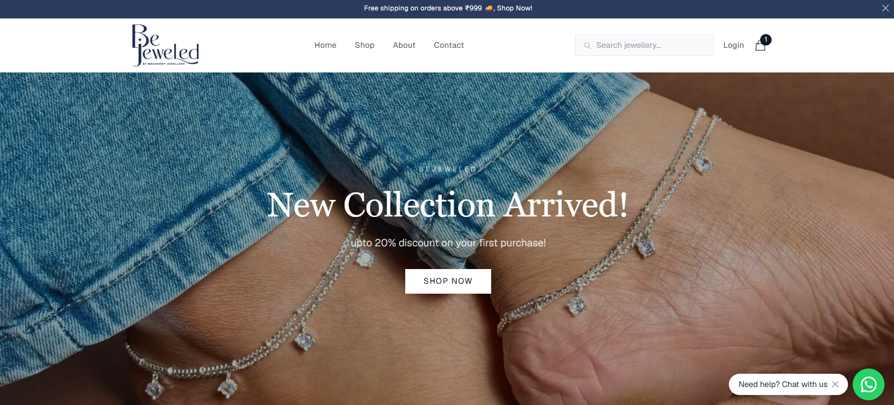
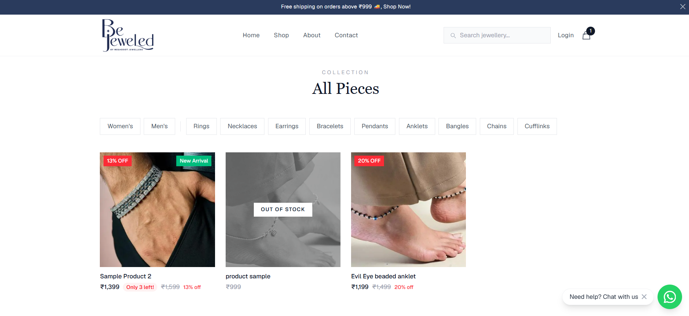
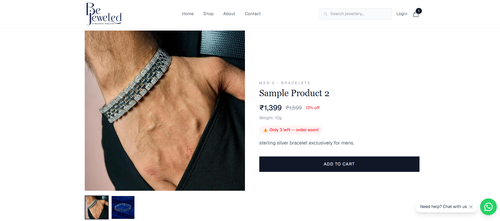
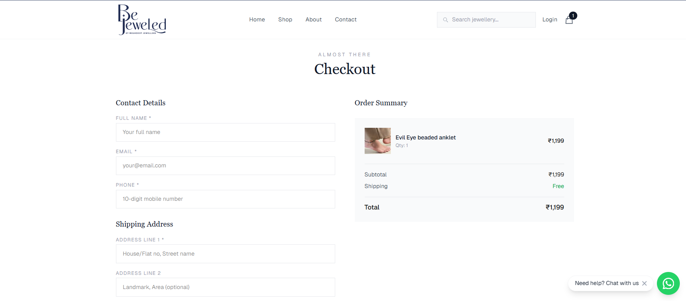
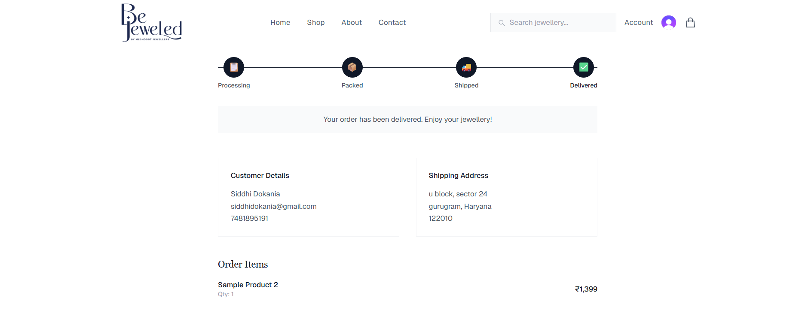
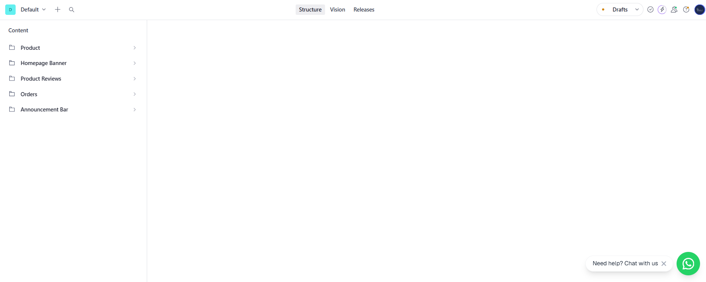

<div align="center">


# BeJeweled — Handcrafted Silver Jewellery

**A full-stack e-commerce platform built with Next.js, Sanity CMS, and Clerk Auth**

[](https://nextjs.org/)
[](https://www.typescriptlang.org/)
[](https://tailwindcss.com/)
[](https://www.sanity.io/)
[](https://clerk.com/)
[](https://vercel.com/)

[🌐 Live Demo](https://bejeweledbymdj.vercel.app) · [📦 Sanity Studio](https://bejeweledbymdj.vercel.app/studio)

</div>

---

## 📖 About

BeJeweled is a real-world e-commerce platform for a handcrafted silver jewellery brand. Built from scratch with a focus on performance, SEO, and a seamless shopping experience — from product discovery to order tracking.

The platform includes a **headless CMS** so non-technical team members can manage products, banners, announcements, and orders without touching any code.

---

## ✨ Features

### 🛍️ Shopping Experience
- Product catalog with **gender + category filters**
- **Real-time search** with autocomplete suggestions and typo tolerance
- Product image gallery with **thumbnail navigation**
- **Discount pricing** — strikethrough MRP, % off badges
- Related products on every product page
- Fully **responsive** — mobile first design

### 🛒 Cart & Checkout
- Persistent cart (survives page refresh via localStorage)
- Cart item count badge on navbar
- Full checkout flow with Indian address form
- **Cash on Delivery** support
- **Razorpay** integration ready (online payments)
- Free shipping logic (above ₹999)

### 👤 Auth & Accounts
- Email OTP authentication via **Clerk**
- Protected account page
- **Pre-filled checkout** for logged-in users
- Order history with live status

### 📦 Order Management
- Unique order numbers (BJ-1001, BJ-1002...)
- Full order tracking page — Processing → Packed → Shipped → Delivered
- Tracking number + courier info support
- Order confirmation emails via **Resend**

### 🎛️ Content Management (Sanity Studio)
- Add/edit/delete products with images, pricing, stock
- Manage **homepage banners** (sale announcements, new collections)
- **Announcement bar** (free shipping offers etc.)
- View and manage all orders
- Approve/reject product reviews
- Non-technical friendly dashboard

### 🔍 SEO & Performance
- Dynamic **sitemap.xml** and **robots.txt**
- Open Graph meta tags for social sharing
- Google Search Console verified
- Server-side rendering for all product pages
- Optimized images via Next.js Image

---

## 🏗️ Tech Stack

| Layer | Technology |
|---|---|
| **Framework** | Next.js 16 (App Router, Turbopack) |
| **Language** | TypeScript |
| **Styling** | Tailwind CSS |
| **CMS** | Sanity (headless) |
| **Auth** | Clerk (email OTP) |
| **Email** | Resend |
| **Payments** | Razorpay (integration ready) |
| **Deployment** | Vercel |
| **Version Control** | GitHub |

---

## 🗂️ Project Structure
bejeweled/
├── app/                    # Next.js App Router pages
│   ├── shop/               # Product catalog with filters
│   ├── product/[slug]/     # Dynamic product pages
│   ├── cart/               # Shopping cart
│   ├── checkout/           # Checkout flow
│   ├── order/[orderNumber] # Order status tracking
│   ├── account/            # User account + order history
│   ├── studio/             # Embedded Sanity Studio
│   └── api/                # API routes (search, orders, contact, reviews)
├── components/             # Reusable React components
│   ├── Navbar.tsx          # Search, auth, cart badge
│   ├── HeroBanner.tsx      # CMS-driven banner slider
│   ├── ProductCard.tsx     # Product card with discounts
│   ├── SearchBar.tsx       # Autocomplete search
│   └── ...
├── lib/
│   ├── sanity.ts           # Sanity client
│   ├── cartContext.tsx     # Global cart state
│   └── generateOrderNumber.ts
├── sanity/schemas/         # CMS content models
│   ├── product.ts
│   ├── order.ts
│   ├── banner.ts
│   ├── announcement.ts
│   └── review.ts
└── middleware.ts           # Clerk auth middleware

---

## 🚀 Getting Started

### Prerequisites
- Node.js 18+
- Sanity account
- Clerk account
- Resend account

### Installation

```bash
# Clone the repository
git clone https://github.com/siddhidokania/bejeweledbymdj.git
cd bejeweledbymdj

# Install dependencies
npm install

# Set up environment variables
cp .env.example .env.local
# Fill in your keys (see Environment Variables section)

# Start development server
npm run dev
```

### Environment Variables

```env
# Sanity
NEXT_PUBLIC_SANITY_PROJECT_ID=your_project_id
NEXT_PUBLIC_SANITY_DATASET=production
SANITY_WRITE_TOKEN=your_write_token

# Clerk
NEXT_PUBLIC_CLERK_PUBLISHABLE_KEY=your_publishable_key
CLERK_SECRET_KEY=your_secret_key
NEXT_PUBLIC_CLERK_SIGN_IN_URL=/sign-in
NEXT_PUBLIC_CLERK_SIGN_UP_URL=/sign-up
NEXT_PUBLIC_CLERK_AFTER_SIGN_IN_URL=/account
NEXT_PUBLIC_CLERK_AFTER_SIGN_UP_URL=/account

# Resend
RESEND_API_KEY=your_resend_key
```

---

## 🔄 How It Works

### Product Management Flow
Sister adds product in Sanity Studio
↓
Sanity webhook fires
↓
Vercel auto-redeploys
↓
Product live on website in ~2 minutes

### Order Flow
Customer adds to cart
↓
Checkout (pre-filled if logged in)
↓
Order created in Sanity (BJ-1001)
↓
Email confirmation sent
↓
Sister updates status in Sanity Studio
↓
Customer tracks order at /order/BJ-1001

---

## 📸 Screenshots

> Home Page


> Shop Page with Filters


> Product Detail Page


> Checkout Page


> Order Status Page


> Sanity Studio Dashboard


---

## 🌐 Live Demo

**Website:** https://bejeweledbymdj.vercel.app

**Test the full flow:**
1. Browse products at `/shop`
2. Add items to cart
3. Sign up / log in
4. Complete checkout (use COD)
5. Track your order at `/order/BJ-1001`

---

## 👩‍💻 Author

**Siddhi Dokania**

[](https://linkedin.com/in/siddhidokania)
[](https://github.com/siddhidokania)

---

## 📄 License

This is a private commercial project. All rights reserved.

---

<div align="center">
Built with ❤️ for BeJeweled by Meghdoot Jewellers
</div>